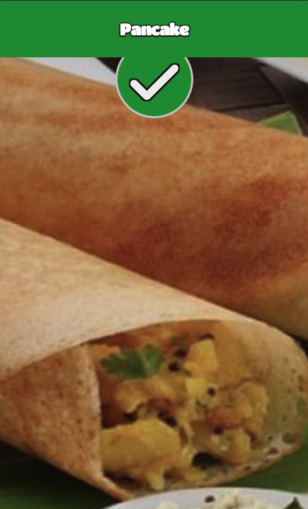
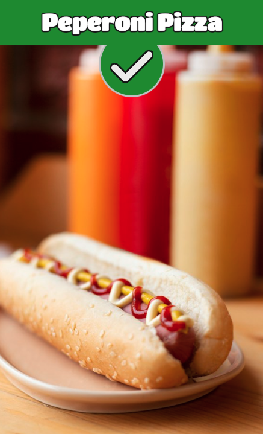
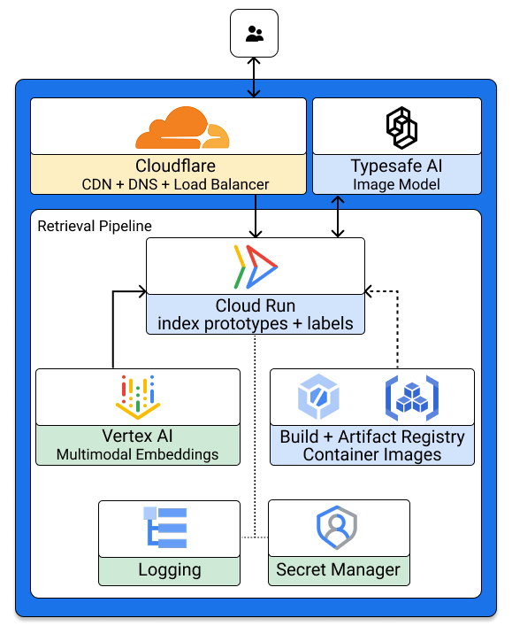
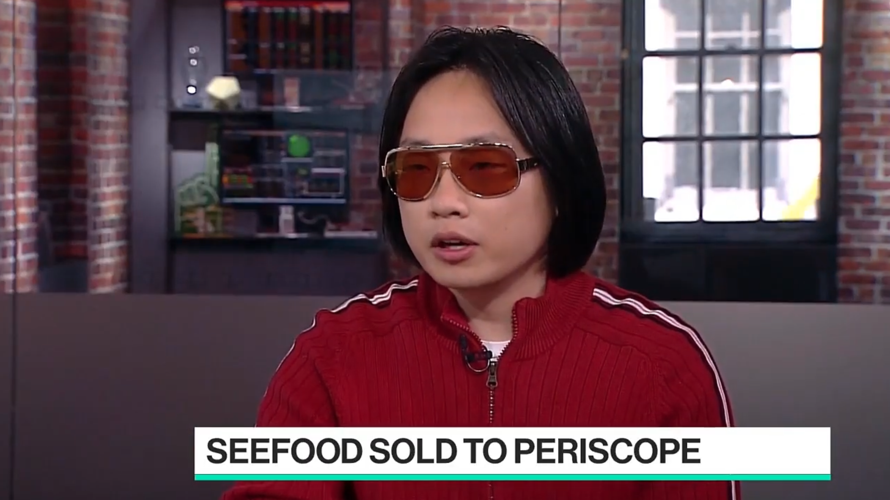

# SeeFood - The Shazam for Food

  

No this does not have 8 octopus recipes. It doesn't just do "hotdogs" and "not hotdogs". SeeFood can now "see" over n foods.

It uses Google’s **EmbeddingGemma 2** to retrieve candidates and Typesafe AI's **Jev** image API to choose among them.

PS. I know I could have used an image model or just called Google Lens, but that wouldn’t have been any fun.

## Run locally

Requires Node.js 20.19+ or 22.12+, Python 3.11+, and the model weights [EmbeddingGemma 2](https://deepmind.google/models/gemma/embeddinggemma/) in `google_embeddinggemma_2/`.

Then start the backend and frontend.

## Journey
I started by testing whether Gemma embeddings alone would be enough. Google has probably trained the model on food from around the world, and because it comes with a vision encoder, I could embed a photo and compare it against reference embeddings using cosine similarity. On Indian food, though, it did poorly. It called a dosa a pancake.

  

To give it better references, I used the [Khana dataset](https://khana.omkarprabhu.in/), which has 80 common dishes with 40 images each. I embedded every reference photo and averaged the embeddings for each dish, hoping that this average, a kind of **visual prototype**, would be more reliable than any single photo.

Then I ran into a strange problem. Almost every food image had a cosine similarity of about 0.9 with almost every dish prototype. Even when the correct dish ranked first, it usually won by a tiny margin.

Claude suggested the cause might be **anisotropy**, where embeddings cluster around a few common directions. Food photos seemed to occupy a narrow region of the embedding space, and what they shared which was enough to classify “this is food” but made it hard to differentiate between foods. To remove that shared signal, I used **mean centering**: averaged all the prototypes and subtracted that average from each one.

The improvement was large. Dishes became much easier to tell apart, so the useful signal had been there all along, hidden under what the photos had in common.

With the 80 dishes working well, I went back to the original test, the hot dog. Hot dogs weren’t in the dataset, and the classifier called it a pepperoni pizza. It also missed dishes like upma that the dataset didn’t cover. When I looked at the scores, the right answer scored lower than the wrong one, and I didn’t know why or how to fix it.

  

I still wanted to recognize dishes beyond those 80, so I scraped several recipe sites and added about 10,000 images. That made things worse in new ways. With thousands of possible matches, non-food detection fell apart, and a spoon came back as a dessert. A single reference image could now outrank a prototype built from many, so on a real samosa, one spring roll photo might beat my samosa prototype. And the classifier began returning wrong names with complete confidence.

I did notice that the correct dish usually ranked near the top of the retrieved results, though it could land anywhere in the top 10, 20 or even 25. Instead of tuning Gemma further to make the final call, I split the job in two: **Gemma retrieves candidates, and Jev decides between them**. which is cheating a bit.

Jev image API accepts up to 255 choices, so I pass it the top 254 candidates plus a “not food” option. Accuracy improved enormously. It still makes mistakes, but I haven’t seen anything bizarre, and I can usually see why it went wrong. It mistook thatte idli for neer dosa, for example, and a blurry close-up of a lemon for "besan ladoo".

## Deployment

  

The embedding model could run in the browser, but I chose to run it in the cloud. Since I didn’t train or fine-tune the model, self-hosting made little sense, and Google’s hosted multimodal embedding model, which bills per request, should be cheaper.

I also baked the index into the build instead of rebuilding it at startup, because computing it on every cold start would hammer the embedding API and slow the container down. One caveat: the hosted model produces 1,408-dimensional embeddings, while the one I tested locally produced 768, so accuracy in production may differ from what I measured.

This set up costs me **$0.25 per 1000 calls**

I haven't tested it extensively so please send it whatever's on your plate and if it gets something wrong raise an issue, I'm curious.

and maybe someday...

  

